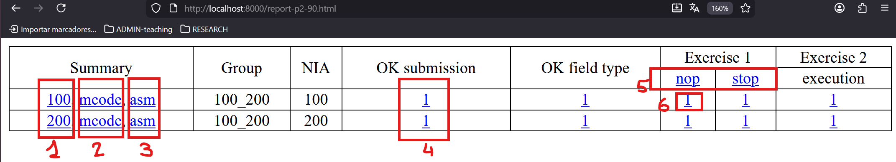

# WepSIM Tester for submissions

## Contents

  * [1. Initial steps](#1-initial-steps)
  * [2. To check one group for the first time](#2-to-check-one-group-for-the-first-time)
  * [3. To check again one group and make the ajustments to the submissions](#3-to-check-again-one-group-and-make-the-ajustments-to-the-submissions)


### 1. Initial steps

1. First, you need to **download the wepsim-tester project**:
2. Next, place **the .zip file with the submissions to be tested** must be placed in the ```submissions/``` directory:
3. Finally, place **the solutions** in the ```test/``` directory files.


<details>
<summary>Click here for more details...</summary>
<br/>

1. First, you need to **download the wepsim-tester project**.<br>
   Two options:
   * a) Download the main .zip file:
     ```console
     wget https://github.com/wepsim/tester/archive/refs/heads/main.zip
     unzip tester-main.zip
     mv tester-main lab_checker
     cd lab_checker
     ```
   * b) Use "git clone":
     ```console
     git clone https://github.com/wepsim/tester.git
     mv tester lab_checker
     cd lab_checker
     ```

2. Next, place **the .zip file with the submissions to be tested** must be placed in the ```submissions/``` directory.<br>
   Two options:
   * a) Make a ```p2-90``` directory inside the ```submissions/``` directory and place inside the student submissions .zip files.<br/>
        So, if we inspect the submissions directory:
        ```console
         find submissions/
        ```
        The output should be similar to:
        ```console
        submissions/
        submissions/p2-90
        submissions/p2-90/100_200.zip
        submissions/...
        ```
   * b) Place in the ```submissions/``` directory the teaching group file (for example, ```p2-90.zip```).<br>
        This ```p2-90.zip``` file contains several .zip files inside, one for each submission from a group of students (```100_200.zip```, etc.). <br>
   
        So, if we list the submissions directory:
        ```console
         ls -1 submissions/
        ```
        The output should be similar to this one:
        ```console
         ...
         p2-90.zip      : The associated .zip file for the group named "90"
        ```
        And inside this file there are each student group submissions:
        ```console
         unzip -v p2-90.zip
         Archive:  p2-90.zip
          Length   Method    Size  Cmpr    Date    Time   CRC-32   Name
         --------  ------  ------- ---- ---------- ----- --------  ----
                0  Stored        0   0% 2025-12-05 01:43 00000000  p2-90/
            49933  Defl:X    49757   0% 2025-12-05 01:43 e5f00b62  p2-90/100_200.zip
         --------          -------  ---                            -------
            49933            49757   0%                            2 files
        ```


3. Finally, complete **the solutions** in the test directory files (labeled as TODO within the files).
   ```console
   ls -las test
   ```

</details>


### 2. To check one group for the first time

1. The typical steps for the example group 90 are (submissions packed in the p2-90.zip file):
   ```console
   ./ws.sh start                                : 1. To spin up one container
    cd /work/results                            : 2. Go to the results directory
   ./s10_unzip.sh    p2-90.zip                  : 3. To unzip the submitted files at p2-90.zip
   ./s10_tests.sh    tests/tests.in             : 4. To get the execution output to compare with
   ./s40_checker.sh  tests/tests.in  p2-90.in   : 5. To check only the 90 group.
    lynx report-p2-90.html                      : 6. To open the associated report within the container
    exit                                        : 7. To exit the container
   ./ws.sh stop                                 : 8. To spin down the container.
   ```

   The following image is an example of report generated:
   <p align="center">
     
   </p>

   Main parts:
   * (1) Summary of all tests.
   * (2) Microcode only.
   * (3) Assembly only.
   * (4) Link to the directory with all submitted files.
   * (5) Links to the assembly code with the corresponding tests executed.
   * (6) Result of a particular test for one particular group.

<details>
<summary>More detailed...</summary>

1. First, you need to spin up the container with:
   ```console
   ./ws.sh start
   ```

2. To unzip the submitted files in p2-90.zip for the group 90 please use:
   ```console
   ./s10_unzip.sh  p2-90.zip
   ```

3. To prepare the execution output to compare with:
   ```console
   ./s10_tests.sh      tests/tests.in
   ```

4. To check only the 90 group:
   ```console
   ./s40_checker.sh    tests/tests.in   p2-90.in
   ```

5. To show the results, first you could start a simple web server with:
   ```console
   python3 -m http.server 8000 &
   ```
   And use outside the container (in your host system) your web browser:
   ```console
   firefox http://localhost:8000/report-p2-90.html
   ```

6. Finally, you can spin down the container:
   ```console
   exit
   ./ws.sh stop
   ```
</details>


### 3. To check again one group and make the ajustments to the submissions

1. First, you need to spin up the container with:
   ```console
   ./ws.sh start
   ```

2. For each submitted work named <xxxxx_yyyyy> that needs some modification please first backup the original files in the *ORIGINAL* subdirectory:
   ```console
   pushd .
   cd p2-90/<xxxxx_yyyyy>/
   mkdir -p      ORIGINAL
   cp    -a  *   ORIGINAL/
   ```

3. Please make the amendments, for example:
   * If file names are not OK (p2-report.pdf, ej2_microcode.txt.txt, etc.)
     ```console
     mv ej2_microcode.txt.txt e2_checkpoint.txt
     ```
   * If e1_checkpoint.txt is not a checkpoint, but the microcode as text:
     ```console
     : Following commands build a checkpoint from the microcode and an empty assembly code
     touch /tmp/empty.asm
     mv    e1_checkpoint.txt   e1_mcode.txt
     ./wepsim.sh -a build-checkpoint -m ep -f e1_mcode.txt -s /tmp/empty.asm > e1_checkpoint.txt
     ```
   * Etc.

4. Usually the adjustments involve penalties for not following what is requested in the statement.
   Please take note of the adjustments in your spreadsheet (or notes associated).
   ```console
   : For example, notes.txt is a log with the adjustments:
   echo "ej2_microcode.txt.txt -> e2_checkpoint.txt"  >> p2-90/<xxxxx_yyyyy>/notes.txt
   ```

5. Check again:
   ```console
   popd
   ./s40_checker.sh  tests/tests.in  p2-90.in
   lynx report-p2-90.html
   ```

6. Finally, you can spin down the container:
   ```console
   exit
   ./ws.sh stop
   ```

